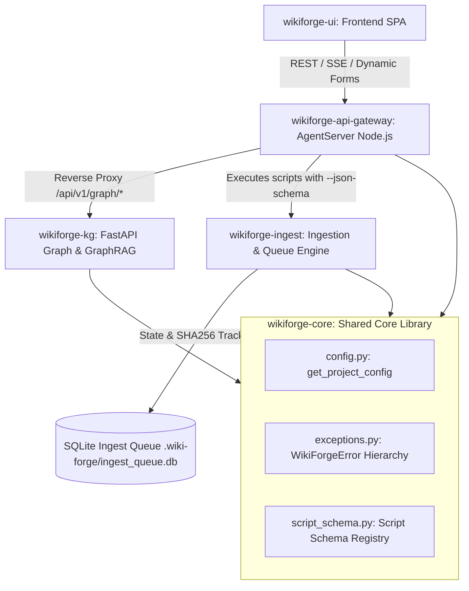

# Technical Architecture & Usage Analysis: `wiki-forge` with Local LLMs and Knowledge Engineering

This document provides a comprehensive technical breakdown of the **`wiki-forge`** architecture. It details the system design, the separation between parametric and non-parametric memory, the multi-provider LLM backend, the Web UI & Script Control Panel, the Open Knowledge Format (OKF v0.2) compliance layer, the Incremental Versioning engine, and a comparison with from-scratch model training (*nanochat*).

---

## 1. Core Architecture & Memory Paradigms

### 1.1 Parametric Memory vs. Non-Parametric Memory

A fundamental principle of `wiki-forge` is the distinction between **Parametric Memory** (neural network weights) and **Non-Parametric Memory** (external, structured Markdown files):

- **Parametric Memory (Pre-training & Fine-Tuning)**:
  Knowledge resides within neural network weights ($W$). Fine-tuning alters response style or probabilistic associations, but cannot guarantee zero-hallucination factual recall or granular provenance tracing.

- **Non-Parametric Memory (LLM-Wiki & RAG)**:
  Knowledge resides in interlinked Markdown documents (`wiki/`). The LLM operates as an **active Knowledge Engineer** (synthesis, extraction, interlinking, auditing) through in-context learning, reading clean structured articles during inference.

### 1.2 System Component Topology (5 Macro-Components Architecture)

---

## 2. Implemented Subsystems & Technical Details

### 2.0 Centralized Core & Exceptions (`wikiforge-core`)
Implemented in `src/backend/wikiforge/core/config.py`, `exceptions.py`, and `script_schema.py`:
- **Centralized Config (`config.py`)**: `get_project_config()` serves as the Single Source of Truth for loading `config.toml` with absolute path resolution relative to project or repository roots, eliminating path manipulation hacks.
- **Standardized Exception Hierarchy (`exceptions.py`)**: Base `WikiForgeError` with specialized domain exceptions (`ConfigError`, `ConversionError`, `IngestionError`, `GraphValidationError`, `QueryExecutionError`) enforcing clean error propagation.
- **Dynamic Script Schema Contract (`script_schema.py`)**: Defines `--json-schema` CLI flag contract across Python tools. Calling `python3 script.py --json-schema` outputs JSON parameter metadata (labels, types, defaults, positional flags, descriptions) used by `AgentServer` to dynamically construct `SCRIPT_REGISTRY` and render UI forms without hardcoded switch blocks.

### 2.0.1 Unified Ingestion Engine (`wikiforge-ingest`)
Implemented in `scripts/conv2md.py` and `scripts/ingest_queue.py`:
- **Single SQLite Ingestion Queue**: Unifies document staging and conversion caching using a persistent SQLite database (`.wiki-forge/ingest_queue.db`), replacing legacy JSON hash caches.
- **State Lifecycle**: Automatically tracks file status (`pending`, `processing`, `completed`, `failed`), retry attempts, and SHA256 hashes to guarantee idempotency and fast cache hits (<10ms).

### 2.1 Decoupled Agent Backend & Multi-Provider LLM Client
Implemented in `src/backend/server/agentServer.ts` and `src/backend/server/llmClient.ts`:
- **Provider Support**: OpenCode CLI (`opencode`), Anthropic API (`claude-3-5-sonnet`), OpenAI-compatible endpoints (`gpt-4o`), local Ollama (`llama3`).
- **Configuration**: Managed via `[agent.llm]` in `config/config.toml` with safe environment variable handling (`api_key_env`).
- **Real-Time SSE Streaming**: `/api/chat` streams chunk-by-chunk LLM responses directly to the Web UI `ChatDrawer`.

### 2.2 Security Hardening & Containment
- **Path Traversal Containment**: All filesystem REST endpoints (`save`, `attach`, `create`, `rename`, `move`, `delete`, `upload`) execute `validateSafePath()`, enforcing strict containment inside `wiki/` or `raw/` and returning HTTP 400 Bad Request on path traversal attempts (`..`).
- **HTML & Markdown Sanitization**: `renderMarkdown` applies XSS sanitization (`src/frontend/core/utils/html.ts`), neutralizing dangerous scripts, iframes, and inline event handlers.

### 2.3 Python Script Execution Engine
Implemented in `src/backend/server/agentServer.ts`, `ToolsModal.ts`, and `LogConsole.ts`:
- **API Endpoints**: `GET /api/scripts/list`, `POST /api/scripts/execute`, `GET /api/files/download`.
- **Execution**: Spawns Python CLI child processes securely via `child_process.spawn('python3', ...)` with strict argument sanitization.
- **Log Streaming**: Real-time Server-Sent Events (SSE) stream `stdout` and `stderr` directly to a terminal-like console in the browser with process cancellation support.

### 2.4 Open Knowledge Format (OKF v0.2) Compliance
Implemented in `config/config.toml` (`[okf]`), `scripts/okf_*.py`, and Makefile:
- **YAML Frontmatter Schema**: Requires `type` (controlled vocabulary), ISO 8601 timestamps (`generated.at`), actor namespaces (`human:<id>`, `<producer>/<version>`, `process:<id>`), `status`, and provenance (`sources`).
- **Trust Tiers**: Computed dynamically: `unverified`, `machine-confirmed`, `human-reviewed`.
- **Validation & Indexing**: `okf_lint.py` validates schema compliance; `okf_reindex.py` auto-generates OKF §8 `index.md`; `okf_log.py` logs chronological changes into `wiki/log.md` (OKF §9); `okf_stats.py` provides bundle analytics.

### 2.5 Incremental Versioning & Snapshot Rollback Engine
Implemented in `scripts/versioning.py`, `wiki/versions/`, `src/frontend/components/advanced-mode/`, and `AGENT.md` (`/rollback`, `/history`, `/diff` commands):
- **Source/Synthesis Isolation**: Original sources remain untouched in `sources/` (`backup/`) and `raw/`.
- **Version Snapshots**: Every `/compile` or major update creates a version snapshot (`wiki/versions/<note>.v1.md`, `.v2.md`).
- **Agent Commands & Web UI**: `/rollback note=<note> [to=version]` restores previous state with safety net backup, `/history` lists snapshots, and `/diff` renders unified diffs. The Web UI includes `VersionHistoryPanel.ts` and `DiffViewer.ts` for timeline view and 1-click restore.

### 2.6 OKF Model Context Protocol (MCP) Server
Implemented in `src/backend/server/mcp_server.py` and `docker-compose.yml`:
- **Tools Exposed**: `search_wiki`, `get_concept_metadata`, `get_line_anchored_citation`, `list_trust_tiers`, and `get_version_history`.
- **Multi-Agent Ecosystem Support**: Enables external LLM agents (Claude, GPT) to query and cite the OKF knowledge base over standard MCP JSON-RPC protocol.

### 2.7 W3C Semantic RDF Exporter & Ontology Rule Engine
Implemented in `scripts/export_semantic.py` and `scripts/ontology_rules.py`:
- **Semantic Export (`export_semantic.py`)**: Exports OKF v0.2 knowledge base notes into W3C standard RDF graph formats (`output/wiki_export.jsonld` and `output/wiki_export.ttl`) for interoperability with Protégé, GraphDB, and SPARQL query engines.
- **Ontology Rule Engine (`ontology_rules.py`)**: Evaluates logical graph constraints:
  - Rule 1: Verifies that every note with `type: Concept` has at least 1 inbound or outbound `[[wikilink]]`.
  - Rule 2: Identifies direct circular dependencies between notes (A -> B -> A).
  - Rule 3: Enforces that notes with `status: stable` contain human verification (`human:*` actor in `verified`).

### 2.8 Enterprise Semantic Knowledge Graph & Stateful GraphRAG System
Implemented in `src/backend/wikiforge/config/shapes.ttl`, `src/backend/wikiforge/semantics/markdown_to_rdf.py`, `markdown_to_cypher.py`, `graph_rag_pipeline.py`, and `.github/workflows/shacl_validation.yml`:
- **W3C SHACL Validation Schema (`shapes.ttl`)**: Formally validates extracted RDF graphs against SHACL shape constraints enforcing unique slug IDs, ISO creation dates, non-empty markdown bodies, author agent IRIs, and typed relation targets (`wf:supports`, `wf:contradicts`, `wf:refersTo`).
- **Dual-Graph Conversion**: Converts Zettelkasten Markdown notes into W3C Turtle RDF graphs and Neo4j Cypher property graph scripts.
- **Stateful GraphRAG Pipeline (`WikiForgeGraphRAG`)**: Agentic workflow built with LangGraph implementing Entity Extraction, Text-to-Cypher translation, Neo4j/Mock execution, automated self-correction error recovery, and grounded synthesis with PROV-O provenance citations.
- **CI/CD Automation**: GitHub Actions workflow automatically verifies SHACL shape conformance and builds graph artifacts on push/PR.

### 2.9 Multi-Project Workspace Management
Implemented in `projects/` and `src/frontend/components/ConfigManager.ts`:
- **Workspace Isolation**: Projects are stored under `projects/<id>/` with independent `config/config.toml`, `sources/`, `raw/`, `wiki/`, `output/`, and `notes/`.
- **GUI Config Manager**: Web UI modal allows editing project metadata, folder paths, LLM provider settings, and OKF taxonomy using `smol-toml`.

### 2.10 HTTP API Server Routing & Operations
Implemented in `src/backend/server/agentServer.ts` and `src/backend/server/httpServer.ts`:
- **Route Dispatch**: `AgentServer.handleRequest()` dispatches every request and returns `true` once it has written a response, or `false` when no route matches. `httpServer.ts` inspects this value and answers `404` (JSON) for unmatched paths and `500` for uncaught handler errors when headers have not yet been sent. Previously the return value was ignored, leaving unknown paths (including routes missing from a stale process) unanswered and hanging the client.
- **Dual Base URL Resolution**: The browser resolves the API via `resolveApiBaseUrl()` (`VITE_API_BASE_URL`, e.g. `http://127.0.0.1:3001`), while the Vite dev server proxies `/api/*` using `VITE_PROXY_TARGET` (`http://api:3001`). These must differ: inside the `ui` container, `127.0.0.1` is not the `api` service.
- **Hot Reload Support**: The `api` service runs `npx tsx watch src/backend/server/httpServer.ts`, which automatically watches `src/backend/server/**` for changes and restarts the HTTP server during development without requiring container restarts.

---

## 3. Comparative Matrix: `wiki-forge` Local RAG vs. From-Scratch Training (`nanochat`)

| Feature / Metric | Solution A: `wiki-forge` Local RAG + LLM | Solution B: From-Scratch `nanochat` Training |
| :--- | :--- | :--- |
| **Primary Goal** | Knowledge Engineering & Production KB | Educational / Transformer Architecture Research |
| **Core Technology** | Non-parametric Markdown KB, RAG, `AGENT.md` | Pre-training, Mid-training, SFT, RL |
| **Knowledge Storage** | External Markdown files (`wiki/`) | Model weights (`.pt` parameters) |
| **Factual Precision** | High (exact passage citations & line-anchors) | Low on specifics (prone to hallucinations) |
| **Compute Cost** | Low (runs on consumer GPU or Apple Silicon) | High (requires multi-GPU clusters for full runs) |
| **Data Ingestion** | Instant (add file and run `compile`) | Slow (requires full re-training or SFT) |
| **Out-of-the-box in `wiki-forge`**| ✅ Native (`[agent.llm]` + Agent Server + UI) | ⬜ External repository (`nanochat`) |

---

## 4. Linee Guida per lo Sviluppo (KISS/DRY)

Per mantenere il codice pulito e manutenibile, tutti i contributori (umani e AI) devono rispettare queste regole:

1. **Singola Responsabilità (KISS)**: Uno script Python in `scripts/` non deve mai mischiare la conversione di formato con la generazione/arricchimento LLM. La conversione di formato (`conv2md.py`) è separata dall'arricchimento semantico (`enrich_cot.py`).
2. **Niente `except Exception:` generici**: Utilizzare sempre eccezioni specifiche oppure la gerarchia di eccezioni definita in `src/backend/wikiforge/core/exceptions.py` (`WikiForgeError`, `ConfigError`, `ConversionError`, `GraphValidationError`).
3. **DRY nei Form UI**: Non hardcodedare mai i parametri di uno script nel frontend. La UI deve generare i form dinamicamente consumando `GET /api/scripts/registry`.
4. **Ereditarietà per i Grafi**: Qualsiasi nuovo esportatore di grafi (es. Gremlin, SQL, Cypher, RDF) deve ereditare da `BaseGraphExporter` in `src/backend/wikiforge/semantics/base_parser.py` per riutilizzare la logica di parsing del frontmatter OKF e dei wikilink.

---

## 5. Final Recommendation

1. **For Production Knowledge Base Management**:
   Use `wiki-forge` with your preferred LLM provider (`ollama`, `anthropic`, `openai_compatible`, or `opencode`). Run `make ui-docker` or `npm run dev` to interact via the Web UI or CLI.

2. **For Thesis & Academic Research**:
   Follow the 5-phase chronological workflow (Ingestion -> Incremental KB Compilation -> Study & Maturity Analysis -> Dynamic Interrogation -> PDF Export via Pandoc).
