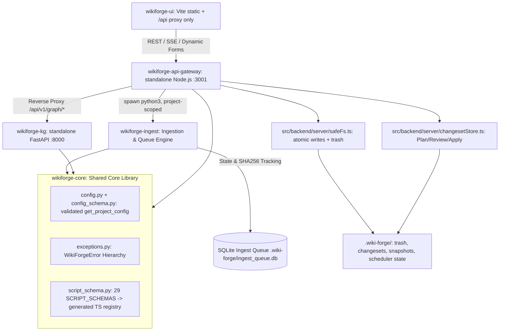

# Technical Architecture & Usage Analysis: `wiki-forge` with Local LLMs and Knowledge Engineering

This document provides a comprehensive technical breakdown of the **`wiki-forge`** architecture. It details the system design, the separation between parametric and non-parametric memory, the multi-provider LLM backend, the Web UI & Script Control Panel, the Open Knowledge Format (OKF v0.2) compliance layer, the Incremental Versioning engine, and a comparison with from-scratch model training (*nanochat*).

---

## 1. Core Architecture & Memory Paradigms

### 1.1 Parametric Memory vs. Non-Parametric Memory

A fundamental principle of `wiki-forge` is the distinction between **Parametric Memory** (neural network weights) and **Non-Parametric Memory** (external, structured Markdown files):

- **Parametric Memory (Pre-training & Fine-Tuning)**:
  Knowledge resides within neural network weights ($W$). Fine-tuning alters response style or probabilistic associations, but cannot guarantee zero-hallucination factual recall or granular provenance tracing.

- **Non-Parametric Memory (LLM-Wiki & RAG)**:
  Knowledge resides in interlinked Markdown documents (`wiki/`). The LLM operates as an **active Knowledge Engineer** (synthesis, extraction, interlinking, auditing) through in-context learning, reading clean structured articles during inference.

### 1.2 System Component Topology (5 Macro-Components Architecture)

I tre processi (`ui`, `api`, `kg-api`) sono servizi separati in `docker-compose.yml`.
`vite.config.ts` non importa il backend: in locale `npm run dev:all` avvia insieme gateway e UI.

---

## 2. Implemented Subsystems & Technical Details

### 2.0 Centralized Core & Exceptions (`wikiforge-core`)
Implemented in `src/backend/wikiforge/core/config.py`, `config_schema.py`, `exceptions.py`, and `script_schema.py`:
- **Centralized Config (`config.py`)**: `get_project_config()` serves as the Single Source of Truth for loading `config.toml` with absolute path resolution relative to project or repository roots, eliminating path manipulation hacks.
- **Declarative Config Validation (`config_schema.py`)**: one `CONFIG_SCHEMA` validates the shape of known sections (types, list item types, nested tables; unknown keys tolerated for forward compatibility). `get_project_config()` raises `ConfigError` listing every problem; the CLI `python -m src.backend.wikiforge.core.config_schema` emits the same result as JSON for external callers.
- **Standardized Exception Hierarchy (`exceptions.py`)**: Base `WikiForgeError` with specialized domain exceptions (`ConfigError`, `ConversionError`, `IngestionError`, `GraphValidationError`, `QueryExecutionError`) enforcing clean error propagation.
- **Single Source of Truth for script metadata (`script_schema.py` → generated registry)**: the 29 `SCRIPT_SCHEMAS` entries are the only definition of script id, path and CLI parameters. `scripts/gen_script_registry.py` emits `src/backend/server/generated/scriptRegistry.generated.ts` (verified by `--check` in CI-style tests); `AgentServer.SCRIPT_REGISTRY` is an alias of that generated object. UI forms and `buildCliArgs()` consume the same metadata. Scripts still answer `python3 script.py --json-schema` for CLI diagnostics, but the backend no longer spawns 29 subprocesses to discover the registry.

### 2.0.1 Unified Ingestion Engine (`wikiforge-ingest`)
Implemented in `scripts/conv2md.py` and `scripts/ingest_queue.py`:
- **Single SQLite Ingestion Queue**: Unifies document staging and conversion caching using a persistent SQLite database (`.wiki-forge/ingest_queue.db`), replacing legacy JSON hash caches.
- **State Lifecycle**: Automatically tracks file status (`pending`, `processing`, `completed`, `failed`), retry attempts, and SHA256 hashes to guarantee idempotency and fast cache hits (<10ms).

### 2.1 Decoupled Agent Backend & Multi-Provider LLM Client
Implemented in `src/backend/server/agentServer.ts` and `src/backend/server/llmClient.ts`:
- **Provider Support**: OpenCode CLI (`opencode`), Anthropic API (`claude-3-5-sonnet`), OpenAI-compatible endpoints (`gpt-4o`), local Ollama (`llama3`).
- **Configuration**: Managed via `[agent.llm]` in `config/config.toml` with safe environment variable handling (`api_key_env`).
- **Real-Time SSE Streaming**: `/api/chat` streams chunk-by-chunk LLM responses directly to the Web UI `ChatDrawer`.

### 2.2 Security Hardening & Containment
- **Path Traversal Containment**: All filesystem REST endpoints (`save`, `attach`, `create`, `rename`, `move`, `delete`, `upload`) execute `validateSafePath()`, enforcing strict containment inside `wiki/` or `raw/` and returning HTTP 400 Bad Request on path traversal attempts (`..`).
- **HTML & Markdown Sanitization**: `renderMarkdown` applies XSS sanitization (`src/frontend/core/utils/html.ts`), neutralizing dangerous scripts, iframes, and inline event handlers.

### 2.3 Python Script Execution Engine
Implemented in `src/backend/server/agentServer.ts`, `ToolsModal.ts`, and `LogConsole.ts`:
- **API Endpoints**: `GET /api/scripts/list`, `POST /api/scripts/execute`, `GET /api/files/download`.
- **Execution**: Spawns Python CLI child processes securely via `child_process.spawn('python3', ...)` with strict argument sanitization.
- **Log Streaming**: Real-time Server-Sent Events (SSE) stream `stdout` and `stderr` directly to a terminal-like console in the browser with process cancellation support.

### 2.4 Open Knowledge Format (OKF v0.2) Compliance
Implemented in `config/config.toml` (`[okf]`), `scripts/okf_*.py`, and Makefile:
- **YAML Frontmatter Schema**: Requires `type` (controlled vocabulary), ISO 8601 timestamps (`generated.at`), actor namespaces (`human:<id>`, `<producer>/<version>`, `process:<id>`), `status`, and provenance (`sources`).
- **Trust Tiers**: Computed dynamically: `unverified`, `machine-confirmed`, `human-reviewed`.
- **Validation & Indexing**: `okf_lint.py` validates schema compliance; `okf_reindex.py` auto-generates OKF §8 `index.md`; `okf_log.py` logs chronological changes into `wiki/log.md` (OKF §9); `okf_stats.py` provides bundle analytics.

### 2.5 Incremental Versioning & Snapshot Rollback Engine
Implemented in `scripts/versioning.py`, `wiki/versions/`, `src/frontend/components/advanced-mode/VersionTimeline.ts`, and the editor's **🕐 Cronologia** button:
- **Source/Synthesis Isolation**: Original sources remain untouched in `sources/` (`backup/`) and `raw/`.
- **Git Auto-Commits**: `scripts/versioning.py` creates an incremental git commit for a note (`version: auto-commit <note> ...`), keeping a repository-level history of changes.
- **Version Snapshots**: the scan scripts skip a reserved `wiki/versions/` folder (`<note>.vN.md`) when present; the frontend timeline itself is built from the note's `version` frontmatter field.
- **Web UI**: the **🕐 Cronologia** button in the editor header opens the **Version History & Rollback** modal (`VersionTimeline.ts`), which lists the snapshots and offers 1-click **🔄 Rollback to vN** restore. Chat commands `/rollback` and `/history` are **not implemented** (docs only); the chat `/diff` command remains LLM best-effort, while the deterministic diff lives in the **Review Studio** (§2.11).

### 2.6 OKF Model Context Protocol (MCP) Server
Implemented in `src/backend/server/mcp_server.py` and `docker-compose.yml`:
- **Tools Exposed**: `search_wiki`, `get_concept_metadata`, `get_line_anchored_citation`, `list_trust_tiers`, and `get_version_history`.
- **Multi-Agent Ecosystem Support**: Enables external LLM agents (Claude, GPT) to query and cite the OKF knowledge base over standard MCP JSON-RPC protocol.

### 2.7 W3C Semantic RDF Exporter & Ontology Rule Engine
Implemented in `scripts/export_semantic.py` and `scripts/ontology_rules.py`:
- **Semantic Export (`export_semantic.py`)**: Exports OKF v0.2 knowledge base notes into W3C standard RDF graph formats (`output/wiki_export.jsonld` and `output/wiki_export.ttl`) for interoperability with Protégé, GraphDB, and SPARQL query engines.
- **Ontology Rule Engine (`ontology_rules.py`)**: Evaluates logical graph constraints:
  - Rule 1: Verifies that every note with `type: Concept` has at least 1 inbound or outbound `[[wikilink]]`.
  - Rule 2: Identifies direct circular dependencies between notes (A -> B -> A).
  - Rule 3: Enforces that notes with `status: stable` contain human verification (`human:*` actor in `verified`).

### 2.8 Enterprise Semantic Knowledge Graph & Stateful GraphRAG System
Implemented in `src/backend/wikiforge/config/shapes.ttl`, `src/backend/wikiforge/semantics/markdown_to_rdf.py`, `markdown_to_cypher.py`, `graph_rag_pipeline.py`, and `.github/workflows/shacl_validation.yml`:
- **W3C SHACL Validation Schema (`shapes.ttl`)**: Formally validates extracted RDF graphs against SHACL shape constraints enforcing unique slug IDs, ISO creation dates, non-empty markdown bodies, author agent IRIs, and typed relation targets (`wf:supports`, `wf:contradicts`, `wf:refersTo`).
- **Dual-Graph Conversion**: Converts Zettelkasten Markdown notes into W3C Turtle RDF graphs and Neo4j Cypher property graph scripts.
- **Stateful GraphRAG Pipeline (`WikiForgeGraphRAG`)**: Agentic workflow built with LangGraph implementing Entity Extraction, Text-to-Cypher translation, Neo4j/Mock execution, automated self-correction error recovery, and grounded synthesis with PROV-O provenance citations.
- **CI/CD Automation**: GitHub Actions workflow automatically verifies SHACL shape conformance and builds graph artifacts on push/PR.

### 2.9 Multi-Project Workspace Management
Implemented in `projects/` and `src/frontend/components/ConfigManager.ts`:
- **Workspace Isolation**: Projects are stored under `projects/<id>/` with independent `config/config.toml`, `sources/`, `raw/`, `wiki/`, `output/`, and `notes/`.
- **GUI Config Manager**: Web UI modal allows editing project metadata, folder paths, LLM provider settings, and OKF taxonomy using `smol-toml`.

### 2.10 HTTP API Server Routing & Operations
Implemented in `src/backend/server/agentServer.ts` and `src/backend/server/httpServer.ts`:
- **Route Dispatch**: `AgentServer.handleRequest()` dispatches every request and returns `true` once it has written a response, or `false` when no route matches. `httpServer.ts` inspects this value and answers `404` (JSON) for unmatched paths and `500` for uncaught handler errors when headers have not yet been sent. Previously the return value was ignored, leaving unknown paths (including routes missing from a stale process) unanswered and hanging the client.
- **Explicit runtime boundary (A2/A3)**: `AgentServer` lives **only** in the standalone process `src/backend/server/httpServer.ts` (`:3001`), started by `npm run api` or the compose `api` service. `vite.config.ts` is a pure static server + reverse proxy: one shared `apiProxy()` is registered on both `configureServer` and `configurePreviewServer`, and it pipes the upstream body so SSE streams are not buffered. On proxy failure the client receives a JSON 502 that suggests `npm run api` / `npm run dev:all`.
- **Dual Base URL Resolution**: The browser resolves the API via `resolveApiBaseUrl()` (`VITE_API_BASE_URL`, e.g. `http://127.0.0.1:3001`), while the Vite dev server proxies `/api/*` using `VITE_PROXY_TARGET` (`http://api:3001`). These must differ: inside the `ui` container, `127.0.0.1` is not the `api` service.
- **Standalone Python API (A2)**: `src/backend/wikiforge/api/api_server.py` (`/api/v1/health`, `/api/v1/graph/sync|validate|rag`) runs as the compose service `kg-api` on internal port `:8000`; the Node gateway sets `FASTAPI_SERVER_URL=http://kg-api:8000` and proxies `/api/v1/graph/*` there, preserving a single public API surface.
- **Hot Reload Support**: The `api` service runs `npx tsx watch src/backend/server/httpServer.ts`, which automatically watches `src/backend/server/**` for changes and restarts the HTTP server during development without requiring container restarts. `scripts/devAll.mjs` provides the equivalent two-process launcher for local `npm run dev:all`.

### 2.11 Review Studio API & Local Snapshot Store
Implemented in `src/frontend/components/review/ReviewStudio.ts`, `ReviewContextMenu.ts`, `src/frontend/core/types/review.ts`, `src/frontend/storage/ApiStorage.ts`, `src/frontend/styles/review-studio.css`, and `src/backend/server/agentServer.ts`.

**UI surface**
- One modal with four horizontal tabs: **Verifica**, **Critica**, **Digest**, **Confronta versioni**. The default tab is `verify`.
- Opened by right-clicking a note in the sidebar (`ReviewContextMenu`), by the **🧐 Revisione** button in the editor header, or with `Ctrl+Alt+R/C/D/F`.
- Only the dark theme is supported; the accent colour is emerald (`#10b981`).

**REST endpoints** (all accept `projectId`; `note` is a wiki-relative path such as `wiki/temi/nota.md` or an id/title resolvable by `resolveReviewTarget`):

| Method & path | Purpose |
|---|---|
| `GET /api/notes/review/meta?note=` | Note identity, status, trust tier, tags, links, sources, verification history, snapshot count and the quality gate. |
| `POST /api/notes/review/verify` | Body `{ note, reviewer?, comment?, setStable? }`; reuses `recordHumanVerification` (the same path as chat `/verify`). |
| `GET /api/notes/review/digest?days=&scope=&note=` | Deterministic activity digest from `wiki/log.md` (`days` clamped to 1–365; `scope` = `all`, `folder`, `note`). |
| `POST /api/notes/review/critique` | Body `{ note, depth?: fast\|standard\|deep, focus?, instructions? }`; LLM critique with deterministic fallback. |
| `GET /api/notes/review/snapshots?note=` | Lists local snapshots (`id`, `at`, `reason`, `bytes`), newest first. |
| `GET /api/notes/review/diff?note=&snapshot=` | Row-based diff (`rows: {type,leftNo,rightNo,left,right}`) plus `stats {added, removed, context}`. |
| `POST /api/notes/review/restore` | Body `{ note, snapshot }`; snapshots the current content, then restores and returns the updated note. |

**Quality gate** (`getReviewMeta`) evaluates five deterministic checks: internal links (broken-link count), OKF frontmatter (`title`, `tags`, `status`, `generated`, `sources`), tag taxonomy, cited sources, and `stale_after`. Each item carries `key`, `label`, `ok`, `value` and `detail`.

**Verification path** — `recordHumanVerification` is shared by the chat command and the tab, so it stays idempotent per reviewer, appends the OKF `verified` entry (`by: human:<id>`, `at`), optionally promotes `status: stable`, writes `wiki/log.md`, and snapshots the pre-write content.

**Snapshot store**
- Path: `.wiki-forge/snapshots/<note-path-without-wiki-and-.md>/<timestamp>.md`, with a `.json` sidecar `{ at, reason, path }`.
- Written before note saves, verifications and restores (`reason` = `salvataggio`, `verifica`, `pre-ripristino`).
- Retention: the latest **25** `.md`/`.json` pairs per note; older ones are deleted.
- Best-effort: snapshot failures never block the note write. The folder is gitignored and requires no git binary (which is unavailable inside the API container).

**Determinism & fallbacks**
- `meta`, `digest`, `snapshots`, `diff` and `restore` are deterministic and work offline.
- `critique` calls the configured LLM when available; otherwise it returns a deterministic Markdown report (`fallback: true`) so the tab remains usable.
- Missing `note` parameters return `400`; unknown notes/snapshots return `404`; unexpected errors return `500` with a JSON body.

### 2.12 Research Studio API & Deterministic Query Helpers
Implemented in `src/frontend/components/research/ResearchStudio.ts`, `src/frontend/core/types/research.ts`, `src/frontend/styles/research-studio.css`, the `research*` methods of `src/frontend/storage/ApiStorage.ts`, `src/backend/server/researchHelpers.ts`, and the six routes in `src/backend/server/agentServer.ts`.

**UI surface**
- One modal with six horizontal tabs: **Consult**, **Ricerca**, **Backlink**, **Correlate**, **Traccia**, **Deep Research**. The default tab is `search`.
- Reuses the Review Studio shell (`.wf-rs-*`) with a cyan accent (`#38bdf8`) and the `.wf-rq-*` classes for result cards, snippets, chips and source passages.
- Entry points: **🔎 Research** in the top header (`Header.ts`), **🔎 Ricerca** in the editor header (`MarkdownEditor.ts`), the note context menu entries **Backlink della nota** / **Correlazioni suggerite** (`ReviewContextMenu.ts`), shortcuts `Ctrl+Alt+Q/S/B/L/T/H`, and the six chat commands (`ChatDrawer.ts` intercepts them before streaming and opens the matching tab with the query pre-filled).

**REST endpoints** (all accept `projectId`; `note` is an id, title or wiki-relative path resolvable by `resolveReviewTarget`):

| Method & path | Purpose |
|---|---|
| `GET /api/notes/research/search?q=&limit=` | Deterministic full-text search (title/id/tag weights + phrase bonus). `limit` clamped to 1–100, default 30. Returns `query`, `total`, `totalMatches`, `scanned`, `tookMs`, `results: {note, score, matchCount, matches[]}` with up to 4 line-numbered snippets per note. |
| `GET /api/notes/research/backlinks?note=` | Notes whose `[[wikilinks]]` resolve to the target, with the first citing line and snippet. The target itself is excluded. `404` for an unknown note. |
| `GET /api/notes/research/related?note=&limit=` | Notes sharing tags/vocabulary with the target that are **not linked yet** (outbound or backlink). Score = `tags × 6 + min(sharedTerms, 12)`; `limit` clamped to 1–50, default 12. |
| `GET /api/notes/research/trace?q=` | Notes matching the query in id/title/body/outbound links (`matchedIn`), their outbound links, and the raw sources declared in frontmatter `sources:` or the `## Sources` section. Anchors `#L10-L25` are read verbatim; without an anchor the query is searched in the raw file and the passage is flagged `inferred`. Missing files are reported with `exists: false`. |
| `POST /api/notes/research/consult` | Body `{ question }`. Ranks the notes with `searchNotes(..., 8)` and sends them as `contextNotes` to the configured LLM with a fixed three-section prompt. Returns `{ success, markdown, fallback, citations[] }`; on provider failure it returns a deterministic answer listing the matching notes (`fallback: true`). |
| `POST /api/notes/research/deep-research` | Body `{ question }`. Filters notes containing at least one query word, writes `output/research-<slug>-<date>.md` and `wiki/synthesis/<slug>.md` (frontmatter `tags: [deep-research, synthesis, …]`, `sources`), and returns `{ success, markdown, outputPath, synthesisPath, articles, fallback }`. The LLM rewrites the report body when available; the deterministic report with Executive Summary, Thematic Deep-Dive, Source Attribution Matrix and Knowledge Gaps is always produced first. |

**Determinism & fallbacks**
- `search`, `backlinks`, `related` and `trace` never call a model: they are pure helpers over the notes already loaded by `readAllWikiNotes`, unit-tested in `tests/researchStudio.test.ts`.
- `consult` and `deep-research` call the configured LLM and fall back deterministically (`fallback: true`) when it is unavailable, so both tabs stay usable offline.
- Missing query/note parameters return `400`; unknown notes for backlinks/related return `404`; unexpected errors return `500` with a JSON body.
- Deep research writes files only through the backend; the modal refreshes the vault after a successful run.

### 2.13 Study Studio API & Deterministic Study Helpers
Implemented in `src/frontend/components/study/StudyStudio.ts`, `src/frontend/core/types/study.ts`, `src/frontend/styles/study-studio.css`, the `study*` methods of `src/frontend/storage/ApiStorage.ts`, `src/backend/server/studyHelpers.ts`, and the seven routes in `src/backend/server/agentServer.ts`.

**UI surface**
- One modal with seven horizontal tabs: **Guida**, **Quiz**, **Mindmap**, **Audio**, **Note**, **Promuovi**, **Tesi** (`StudyStudio.ts`). The default tab is `guide`.
- Reuses the Review Studio shell (`.wf-rs-*`) with an amber accent (`#f59e0b`) and the `.wf-st-*` classes for source lists, scratchpad entries, badges and maturity rows.
- Entry points: **📚 Studio** in the top header (`Header.ts`), **📚 Studio** in the editor header (`MarkdownEditor.ts`), the note context menu entries **Guida di studio** / **Quiz di autovalutazione** / **Mappa concettuale** / **Copione audio** (`ReviewContextMenu.ts`), and shortcuts `Ctrl+Alt+G/K/M/A`. The chat commands keep their text behaviour and share the same builders.
- The opened tab can prefill its topic from the current note; the Mindmap tab uses that title as the tree root.

**REST endpoints** (all `POST`, JSON body, `projectId` from the query string):

| Path | Body | Purpose |
|---|---|---|
| `/api/notes/study/guide` | `{ topic? }` | Builds a study guide from the most relevant notes and writes `output/study-guide-<slug>.md`. Returns `{ success, markdown, outputPath, sources[] }`. |
| `/api/notes/study/quiz` | `{ topic?, count? }` | Builds an exact number of multiple-choice questions (`count` clamped to 1–25, default 5) and writes `output/quiz-<slug>.md`. Returns the output shape plus `count`. |
| `/api/notes/study/mindmap` | `{ target? }` | Selects a note by id, title or path (falling back to the first note), extracts `##`/`###` headings and outbound wikilinks, and writes `output/mindmap-<slug>.md`. Returns `note`, `nodes[]`, `links[]`, `headings`, `wikilinks`; `404` only when the wiki is empty. |
| `/api/notes/study/audio-overview` | `{ topic? }` | Builds a Host A / Host B dialogue script with the covered notes in frontmatter and writes `output/audio-script-<slug>.md`. |
| `/api/notes/study/note` | `{ text }` | Appends a timestamped entry to `notes/quick-notes.md` and returns `{ success, markdown, entry?, entries[] }` so the modal can refresh without a second call. Empty text returns `400`. |
| `/api/notes/study/promote-note` | `{ noteId, folder? }` | Promotes the matching scratchpad entry into `wiki/<folder>/<slug>.md`, updates the folder and master indexes, and returns the created `note`. `400` when the id is missing or the scratchpad does not exist. |
| `/api/notes/study/thesis-chapter` | `{ topic?, title?, minMaturity? }` | Aggregates `tipo: capitolo_tesi` notes (ordered by `capitolo_numero`) and `tipo: sintesi` notes at or above `maturita >= minMaturity`. Writes `output/thesis-<slug>.md` and refreshes the canonical `output/thesis_compiled.md` used by `export_thesis_pdf.py`. Returns `title`, `chapters[]`, `syntheses[]` and `sources[]`. |

**Determinism & edge cases**
- Every tab is deterministic: `studyHelpers.ts` is a pure module over the notes already loaded by `readAllWikiNotes`, unit-tested in `tests/studyHelpers.test.ts`. No LLM provider is involved.
- Structural notes (`index`, `log`, `README`, `sources`-style entries) are filtered out of topic matching via `usableStudyNotes`; slugs are normalised with `slugifyTopic`.
- `sources` are built from `note.path` (already `wiki/...`), avoiding the historical `wiki/wiki/...` double prefix.
- `/promote-note` uses the selected entry text when `noteId` matches a parsed scratchpad entry; a timestamp id (`YYYY-MM-DD...`) derives the article title from the note text, while a plain slug keeps the legacy `/promote-note <slug> <folder>` behaviour.
- Promotion and note creation trigger `executeReindexWorkflow`, so the modal refreshes the vault and the scratchpad panel after a successful run.

### 2.14 Safe Filesystem Layer, Changesets & Project Scoping

Implemented in `src/backend/server/safeFs.ts`, `src/backend/server/changesetStore.ts`, `src/backend/server/toolPaths.ts`, `scripts/okf_common.py` and `src/frontend/storage/ApiStorage.ts`.

**Safe filesystem (A5/A11)**
- `atomicWriteFile()` writes to a temp file in the same directory and renames it over the target; a failed write leaves the previous content intact. All 23 note/config write sites in `agentServer.ts` use it.
- `softDelete()` moves a file/directory to `<project>/.wiki-forge/trash/<id>` and appends a JSONL manifest entry. `listTrash()` / `restoreFromTrash()` expose undo. `DELETE`-like API operations never call `unlink`.
- REST: `POST /api/wiki/delete` returns the trash entry; `GET /api/wiki/trash` lists it; `POST /api/wiki/trash/restore` with `{ id }` restores it.

**Changesets (A7)**
- `ChangesetStore` stages `{ description, rationale, sources, edits[] }` as `<project>/.wiki-forge/changesets/cs-*.json`, capturing the original bytes. Staging never writes to `wiki/`.
- `POST /api/v1/changesets` (stage), `GET /api/v1/changesets?status=pending` (review queue), `GET /api/v1/changesets/:id`, `POST /:id/apply`, `POST /:id/reject`. All endpoints are project-scoped via `X-Project-Id`.
- Edits use either an exact `find`/`replace` pair (single occurrence) or full `proposed_content`; a stale `find` aborts the whole apply. `delete` edits go through `softDelete`, so even an applied changeset is reversible.
- UI: **📋 Proponi changeset** next to the LLM edit button in `ChatDrawer.ts` stages the proposal, and the **📋 Changesets** header button opens `ChangesetReviewModal`. `ChangesetReviewModal` sends `X-Project-Id` on list/apply/reject like the other modals.
- The F5/F6 approval queue remains the gate for *scheduled* mutating steps; changesets are the gate for *interactive LLM* writes. Both now persist under the same `.wiki-forge/` state root.

**Project scoping & tooling paths**
- The header picker value is sent as `X-Project-Id` (and `projectId` in bodies) by Script Control Panel, KE Workbench and Changeset review. The backend treats the header as authoritative over stale form arguments, and exports `WIKIFORGE_PROJECT_ID` + `WIKI_FORGE_WIKI_DIR` to spawned Python processes.
- `scripts/okf_common.py::resolve_dir()` resolves a bare `wiki` to `<cwd>/wiki` → `projects/<selected>/wiki` → repo root, so scripts behave identically when launched from the repo root or a project root.
- `resolveToolScript(rootDir, relativePath)` in `toolPaths.ts` keeps tool sources in the installation root even when `AgentServer` is constructed with a project-only data root (the reason the old inline reindex writer existed).

---

## 3. Comparative Matrix: `wiki-forge` Local RAG vs. From-Scratch Training (`nanochat`)

| Feature / Metric | Solution A: `wiki-forge` Local RAG + LLM | Solution B: From-Scratch `nanochat` Training |
| :--- | :--- | :--- |
| **Primary Goal** | Knowledge Engineering & Production KB | Educational / Transformer Architecture Research |
| **Core Technology** | Non-parametric Markdown KB, RAG, `AGENT.md` | Pre-training, Mid-training, SFT, RL |
| **Knowledge Storage** | External Markdown files (`wiki/`) | Model weights (`.pt` parameters) |
| **Factual Precision** | High (exact passage citations & line-anchors) | Low on specifics (prone to hallucinations) |
| **Compute Cost** | Low (runs on consumer GPU or Apple Silicon) | High (requires multi-GPU clusters for full runs) |
| **Data Ingestion** | Instant (add file and run `compile`) | Slow (requires full re-training or SFT) |
| **Out-of-the-box in `wiki-forge`**| ✅ Native (`[agent.llm]` + Agent Server + UI) | ⬜ External repository (`nanochat`) |

---

## 4. Linee Guida per lo Sviluppo (KISS/DRY)

Per mantenere il codice pulito e manutenibile, tutti i contributori (umani e AI) devono rispettare queste regole:

1. **Singola Responsabilità (KISS)**: Uno script Python in `scripts/` non deve mai mischiare la conversione di formato con la generazione/arricchimento LLM. La conversione di formato (`conv2md.py`) è separata dall'arricchimento semantico (`enrich_cot.py`).
2. **Niente `except Exception:` generici**: Utilizzare sempre eccezioni specifiche oppure la gerarchia di eccezioni definita in `src/backend/wikiforge/core/exceptions.py` (`WikiForgeError`, `ConfigError`, `ConversionError`, `GraphValidationError`).
3. **DRY nei Form UI**: Non hardcodedare mai i parametri di uno script nel frontend. La UI genera i form dinamicamente consumando `GET /api/scripts/registry`, che ora è generato da `SCRIPT_SCHEMAS` in Python. Aggiungere uno script significa aggiungere **una sola** voce Python e rigenerare con `python scripts/gen_script_registry.py` (`--check` in CI). Nessun probe `--json-schema` a runtime e nessuna seconda copia TypeScript da mantenere.
4. **Ereditarietà per i Grafi**: Qualsiasi nuovo esportatore di grafi (es. Gremlin, SQL, Cypher, RDF) deve ereditare da `BaseGraphExporter` in `src/backend/wikiforge/semantics/base_parser.py` per riutilizzare la logica di parsing del frontmatter OKF e dei wikilink.

---

## 5. Final Recommendation

1. **For Production Knowledge Base Management**:
   Use `wiki-forge` with your preferred LLM provider (`ollama`, `anthropic`, `openai_compatible`, or `opencode`). Run `docker compose up` (UI + API + FastAPI), `make dev-all` / `npm run dev:all` in locale, or `make ui-docker` for the UI container alone. `npm run dev` starts Vite only: keep `npm run api` running alongside it.

2. **For Thesis & Academic Research**:
   Follow the 5-phase chronological workflow (Ingestion -> Incremental KB Compilation -> Study & Maturity Analysis -> Dynamic Interrogation -> PDF Export via Pandoc).
